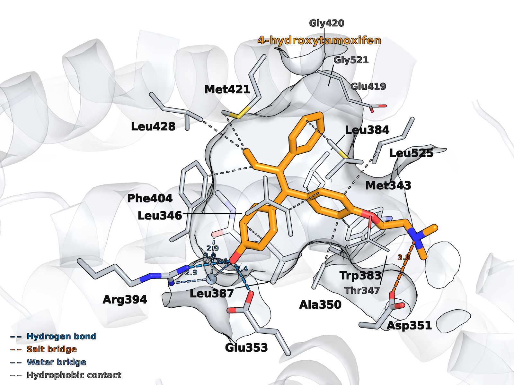
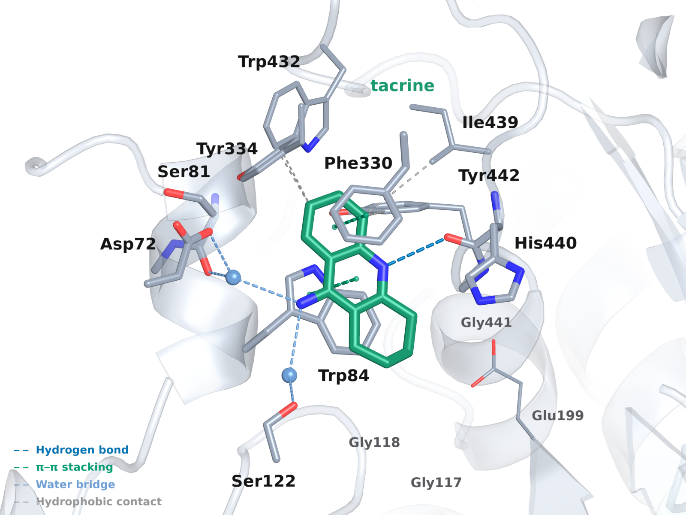
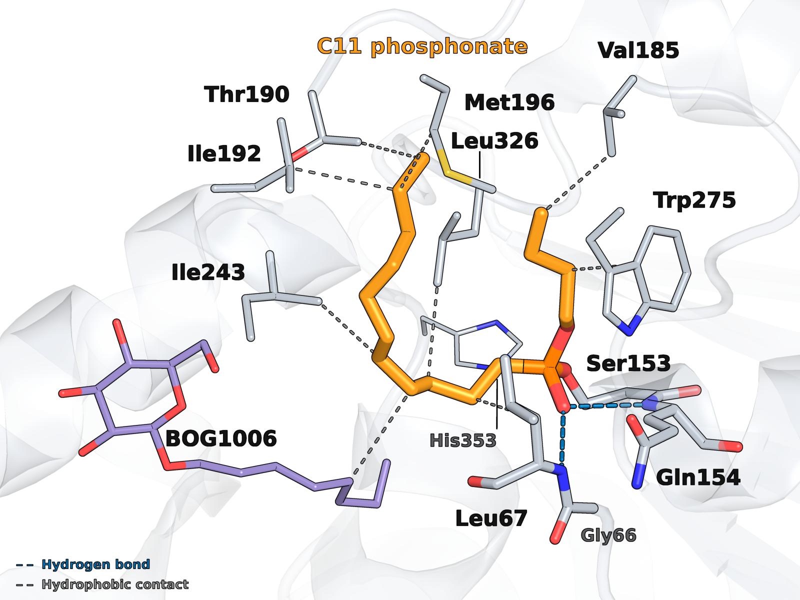
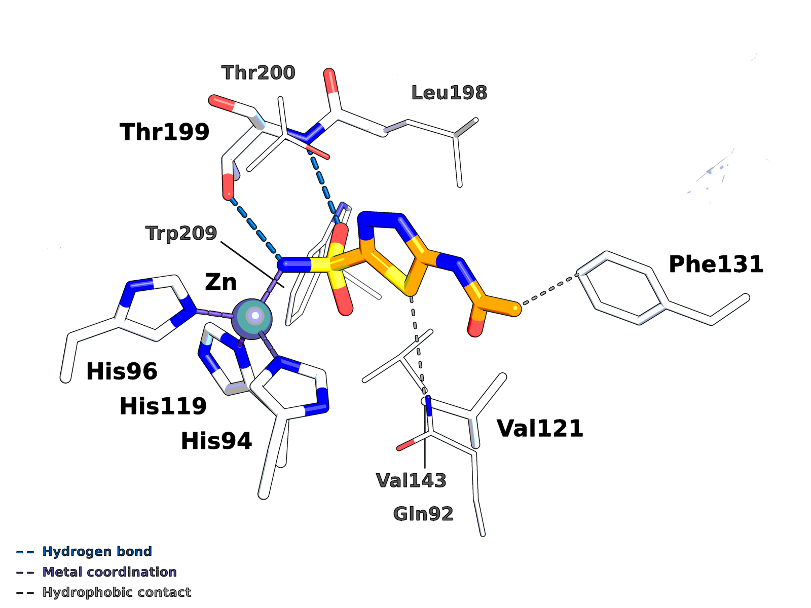
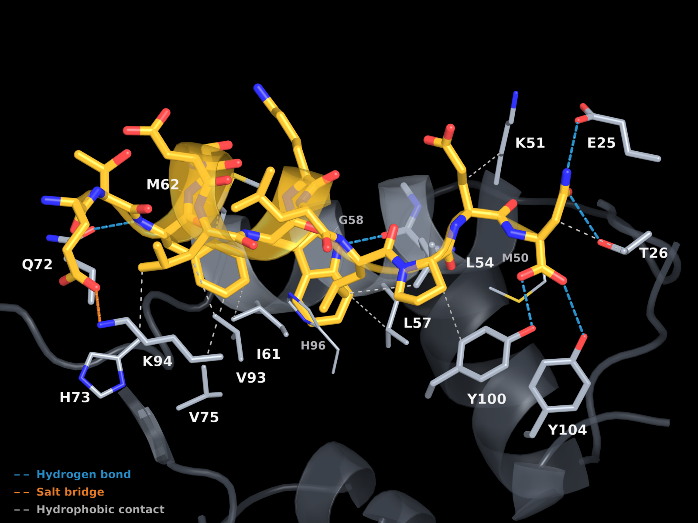
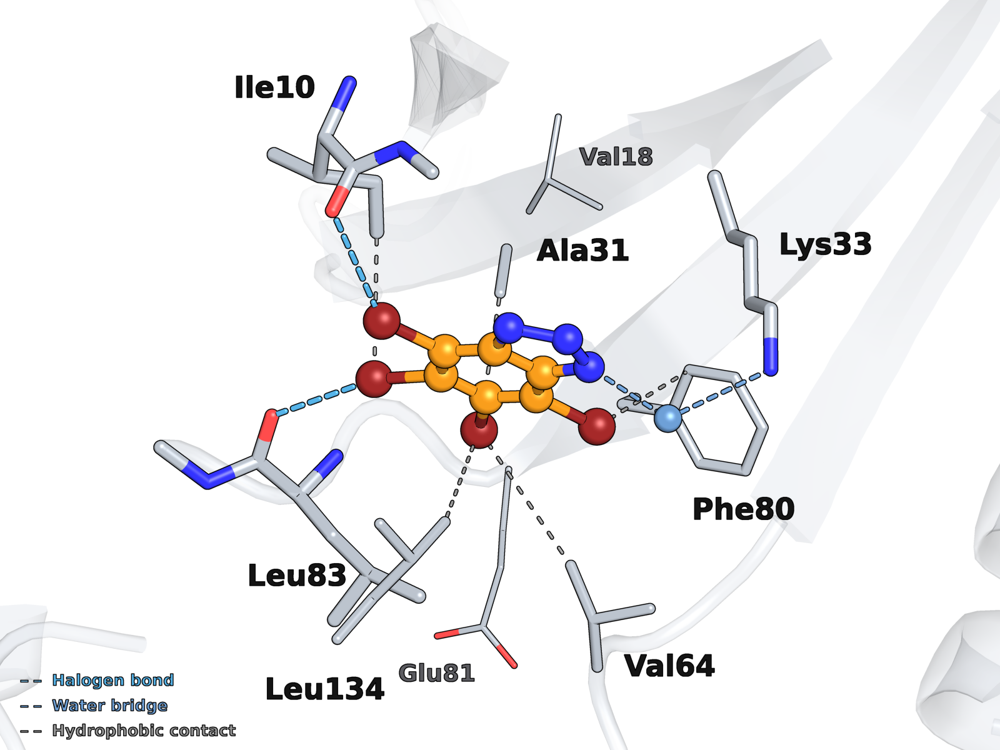
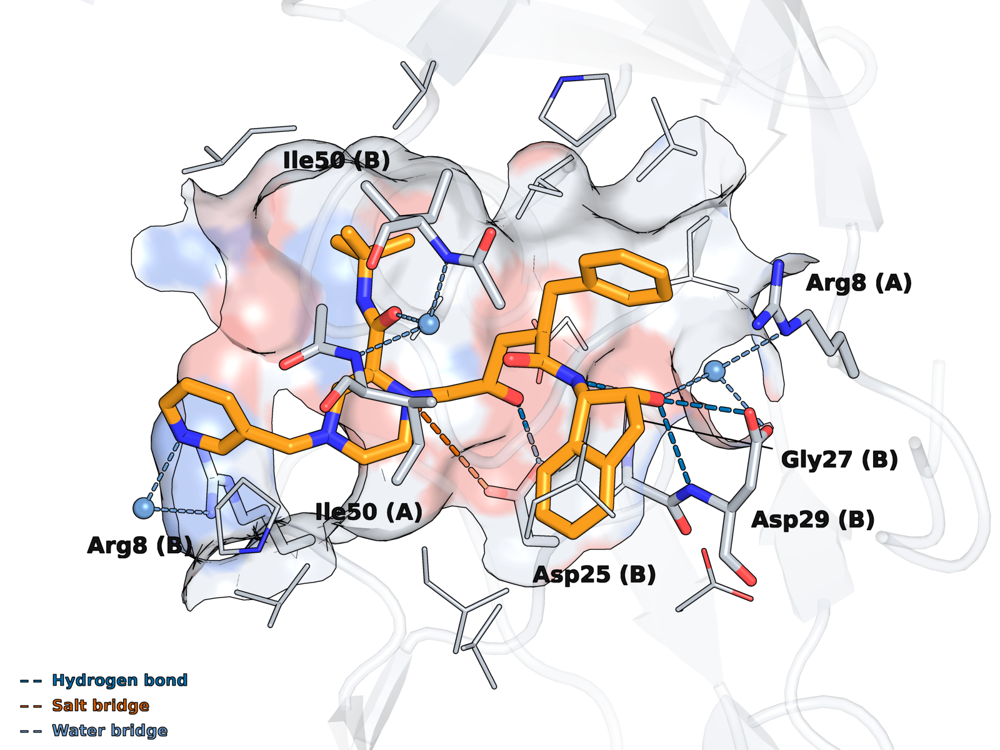

# bindingsite: binding-site figures in one PyMOL command

[](https://github.com/MicheleBonus/pymol-bindingsite/actions/workflows/tests.yml)
[](LICENSE)

`bindingsite` turns a protein–ligand complex into a finished binding-site view:
the ligand, the residues that matter, colour-coded interactions, residue labels
that do not overlap, a colour key, and a camera that looks into the pocket.

```
PyMOL> fetch 1stp
PyMOL> bindingsite
```


It needs only PyMOL and numpy, not RDKit, Open Babel or PLIP. The structure
needs neither hydrogens nor bond orders, because the chemistry is perceived from
the coordinates. Crystal structures, co-folds (Boltz, AlphaFold 3, Chai) and
docking poses all work.

## Install

The plugin is a single file, [`bindingsite.py`](bindingsite.py).

To install it from the web, open *Plugin › Plugin Manager › Install New Plugin*,
paste this address into *Install from PyMOLWiki or any URL* and press *Fetch*:

```
https://raw.githubusercontent.com/MicheleBonus/pymol-bindingsite/main/bindingsite.py
```

To install a downloaded copy, use *Choose file…* on the same tab and pick
`bindingsite.py`. Either way the commands are available after a restart, and the
dialog sits under *Plugin › Binding Site*.

Without the Plugin Manager, add one line to your `pymolrc`:

```
run C:/path/to/bindingsite.py
```

For scripts, `pip install git+https://github.com/MicheleBonus/pymol-bindingsite`
into the Python that has PyMOL makes `import bindingsite` work anywhere (see
[Scripting](#scripting)).

## Everyday use

```
bindingsite                          # find the ligand, do everything
bindingsite resn STI                 # ... for a ligand you name (any selection)
bindingsite chain B                  # a peptide ligand
bindingsite surface=pocket           # add the pocket surface behind the ligand
bindingsite distances=1, style=soft  # distances on the dashes, no outlines

bindingsite_ligands                  # which ligands are there, best candidate first
bindingsite_relabel                  # after rotating: lay the labels out again
bindingsite_view                     # cycle through the ranked camera angles
bindingsite_report                   # interaction table in the console
bindingsite_report site.csv          # ... and as .csv / .tsv / .md
bindingsite_png fig.png, 2400        # ray-traced figure, 2400 px wide
bindingsite_all                      # one scene per loaded complex, same camera
bindingsite_clear                    # remove everything, restore your settings
bindingsite_gui                      # the dialog (also Plugin › Binding Site)
```

`help bindingsite` lists every option. The main ones:

| option | what it does |
|---|---|
| `offset=27` or `offset="A:27,B:-21"` | adds a number to the residue numbers in labels and reports without renumbering the structure, e.g. to show precursor numbering on a mature-chain or construct model |
| `his_positive=1` | treats histidines of unknown protonation as cationic (lysosomal / acidic pH) |
| `style=` | `publication` (white, thin outlines), `soft` (white, no outlines), `flat` (illustrative), `dark` |
| `surface=` | `pocket` or `polar` (N blue, O red); only the part behind the ligand is shown |
| `label_format=` | `{resn}{resi}` gives Ser174, `{r}{resi}` gives S174; also `{RESN}`, `{chain}` |
| `ligand_label=` | a name printed next to the ligand |
| `ligand_color=` | any PyMOL colour for the ligand carbons |
| `ligand_style=` | `sticks` or `ballstick` |
| `radius=` | residues within this distance (default 4 Å) with no specific contact are drawn thin |
| `interactions=` | restrict what is detected, e.g. `hbond,saltbridge,pistack` |
| `receptor=` | what the ligand may interact with. Default: the rest of the ligand's own object, so other complexes loaded alongside stay out of the picture; a ligand alone in its object (docking poses) takes the other enabled objects |
| `view=0` | keep your camera; `restyle=0`, `recolor=0` keep your representation and colours |
| `name=` | prefix of the created objects (default `bs`), for several sites side by side |

Everything is created as ordinary PyMOL objects in a group, so each interaction
type can be switched off in the object panel: `bs.hbond`, `bs.saltbridge`,
`bs.hydrophobic`, `bs.labels`, `bs.legend`, … Selections `bs_ligand`, `bs_pocket`
and `bs_interacting` are left for further use. Only these names are ever
deleted or replaced; `bindingsite` refuses a `name=` that already belongs to
something of yours.

Labels, the colour key and the cut-aways are laid out for the camera at the time
of the call. Rotate freely, then `bindingsite_relabel`.

### Saving a picture

`bindingsite_png fig.png, 2400` ray-traces the view and frames the site for the
shape of the picture, so nothing is cut off when the picture is narrower than
the window. `transparent=1` gives a transparent background.

PyMOL's own `ray 4000, 4000`, `png fig.png, 4000, 4000, ray=1` and the
*Draw/Ray* button work as well. They keep the camera as it is, so a picture
narrower than the window loses its sides.

The labels are sized in Å, which keeps them in proportion when you zoom. PyMOL's
ray-tracer enlarges labels sized in pixels for a picture larger than the window,
but not labels sized in Å. On a 4000-pixel picture they would keep the pixel
size they have on screen and be too small to read. The plugin therefore wraps
`ray` and `png` and corrects the label size of its own objects while a picture
is traced. Labels of other objects are left to PyMOL. So is `draw`, which sized
the labels correctly when checked in PyMOL 3.1.

## Gallery

Each picture is one `bindingsite` call on a PDB entry, followed by
`bindingsite_png`. Nothing was adjusted by hand;
[`examples/make_examples.py`](examples/make_examples.py) regenerates all of them.

<table>
<tr>
<td width="50%" valign="top"><br>
<b>3ERT</b>, 4-hydroxytamoxifen in the oestrogen receptor α: pocket surface, distances, a name for the ligand.<br>
<code>bindingsite surface=pocket, distances=1, ligand_label=4-hydroxytamoxifen</code></td>
<td width="50%" valign="top"><br>
<b>1ACJ</b>, tacrine sandwiched between Trp84 and Phe330 of acetylcholinesterase, with two bridging waters.<br>
<code>bindingsite style=soft, ligand_label=tacrine</code></td>
</tr>
<tr>
<td valign="top"><br>
<b>1K8Q</b>, an alkyl phosphonate bound covalently to the catalytic Ser153 of dog gastric lipase; the phosphoryl oxygen sits in the oxyanion hole.<br>
<code>bindingsite ligand_label="C11 phosphonate"</code></td>
<td valign="top"><br>
<b>3HS4</b>, acetazolamide on the zinc of carbonic anhydrase II; the protein's share of the coordination shell is drawn too.<br>
<code>bindingsite style=flat</code></td>
</tr>
<tr>
<td valign="top"><br>
<b>1YCR</b>, the p53 peptide on MDM2: a peptide ligand, one-letter labels.<br>
<code>bindingsite chain B, style=dark, label_format={r}{resi}</code></td>
<td valign="top"><br>
<b>1P5E</b>, tetrabromobenzotriazole in CDK2: two bromines halogen-bonded to the backbone carbonyls of Leu83 and Ile10.<br>
<code>bindingsite ligand_style=ballstick</code></td>
</tr>
<tr>
<td valign="top"><br>
<b>1HSG</b>, indinavir in HIV-1 protease: a site made of two chains, the flap water bridging to both Ile50, polar surface.<br>
<code>bindingsite surface=polar, hydrophobic=0</code></td>
<td valign="top"></td>
</tr>
</table>

## What is detected

| interaction | default criterion |
|---|---|
| Hydrogen bond | D···A ≤ 3.5 Å, D–H···A ≥ 120°, X–A···D ≥ 90° |
| Salt bridge | oppositely charged atoms ≤ 4.0 Å |
| π–π stacking | centroids ≤ 5.5 Å, ring planes within 30° of parallel or perpendicular, offset ≤ 2.0 Å |
| Cation–π | charge centre to ring centroid ≤ 5.0 Å, offset ≤ 2.0 Å |
| Halogen bond | X···A within the van-der-Waals sum + 0.3 Å, C–X···A ≥ 140° |
| Metal coordination | metal···N/O/S ≤ 2.8 Å; the protein's share of the coordination shell is drawn too |
| Water bridge | both legs ≤ 3.2 Å, angle at the water 71–140° |
| Hydrophobic contact | C···C ≤ 4.0 Å, the closest pair per residue |
| Covalent bond | plausible bond length between ligand and protein |
| Near-attack contact | Ser/Cys/Thr/Lys/Tyr nucleophile ≤ 3.5 Å from a warhead carbon, attack angle 80–130° |
| Steric clash | polar pairs < 2.3 Å, others overlapping by ≥ 0.6 Å |

The geometric windows follow PLIP
([Salentin *et al.*, *Nucleic Acids Res.* 2015](https://doi.org/10.1093/nar/gkv315))
where a hydrogen-free criterion exists; distances are deliberately tighter, because
a figure should show contacts a reader will believe. Change any of them at
runtime: `bindingsite_param hbond_dist, 3.3` (`bindingsite_param` lists them).

Without hydrogens, donors and acceptors come from geometry: hydrogens are placed
where the heavy atoms dictate (amide N–H along the bisector, hydroxyl and
ammonium hydrogens turned towards the acceptor). Amines, amidines and guanidines
are taken as protonated; carboxylates, phosphates, sulfonates and tetrazoles as
deprotonated. If the file has explicit hydrogens, protonation and tautomers are
taken from the file instead. The exception is hydrogens that were plainly added
by filling valences (PyMOL's `h_add` leaves every lysine neutral and every
Asp/Glu protonated): those are ignored, and the report says so.

Multi-state sessions work per object: a single-state receptor next to a
multi-state set of docking poses is analysed for the pose on screen.

## The report

`bindingsite` prints what it drew, and `bindingsite_report` writes the same table
to `.csv`, `.tsv` or `.md` ([example](examples/1stp_biotin_streptavidin.md)). For
the picture at the top of this page:

```
 Binding site of BTN (16 heavy atoms) in 1stp
   Interaction          Residue        Res.atom  Ligand atom    d (A)  angle  note
   ---------------------------------------------------------------------------------------------
   Hydrogen bond        Asn23 A        ND2       O3              2.99    151  protein donates
   Hydrogen bond        Ser27 A        OG        O3              2.77    151  protein donates
   Hydrogen bond        Tyr43 A        OH        O3              2.58    169  protein donates
   Hydrogen bond        Ser45 A        OG        N2              3.04    163  ligand donates
   Hydrogen bond        Asn49 A        N         O12             2.95    153  protein donates, backbone
   Hydrogen bond        Ser88 A        OG        O11             2.69    159  protein donates
   Hydrogen bond        Asp128 A       OD2       N1              2.78    171  ligand donates
   Hydrophobic contact  Trp79 A        CZ2       C8              3.42
   Hydrophobic contact  Thr90 A        CG2       S1              3.74
   Hydrophobic contact  Trp92 A        CZ2       S1              3.76
   Hydrophobic contact  Trp108 A       CD2       C6              3.47
   Hydrophobic contact  Leu110 A       CD2       C9              3.84
   Lining the pocket without a specific contact (<= 4.0 A): Leu25, Val47, Gly48, Ala86
```

## What it warns about

* A pose that overlaps the pocket gets red clash marks in the picture and a
  warning in the report. Without them the figure would make a bad pose look
  acceptable.
* When a file has no bond records for a ligand, PyMOL bonds by distance and can
  tie the ligand to a nearby side chain. Bonds with an implausible length are
  removed and reported.
* A ligand sitting on top of protein atoms usually means a malformed file,
  typically a PDB with a 4-letter residue name, which shifts the coordinate
  columns. The report says so and points to the mmCIF.
* For carbamates, esters, nitriles, Michael acceptors, boronic acids,
  phosph(on)ates and similar warheads, the report gives the distance and the
  Bürgi–Dunitz angle to the nearest nucleophile even when they are outside the
  attack window. Those two numbers separate a Michaelis-like pose from one that
  is merely close.

## Scripting

Every command is also a Python function that returns its result, so the plugin
works in batch jobs without a window:

```python
from pymol import cmd
import bindingsite                      # registers the commands with PyMOL

cmd.load("complex.cif")
site = bindingsite.bindingsite(quiet=1)             # the analysis, as a dict
bindingsite.bindingsite_report("site.csv", quiet=1)
bindingsite.bindingsite_png("site.png", width=2400)

for row in bindingsite.bindingsite_report(quiet=1):
    if row["type"] == "Hydrogen bond":
        print(row["residue"], row["res_atom"], row["lig_atom"], "%.2f" % row["dist"])
```

`import bindingsite` needs the file on the Python path: `pip install` it as shown
under [Install](#install), or put the folder that holds `bindingsite.py` on
`sys.path`.

## Limits

* Protonation is rule-based, not a pKa calculation. Unusual cases (a ring nitrogen
  whose pKa is shifted by the pocket, zwitterions, metal-bound groups) can be
  wrong. A ring nitrogen sitting on a carboxylate is reported as an H-bond with an
  *implied* proton, since two acceptors at that distance must share one.
* Sulfur is not treated as an H-bond donor or acceptor.
* Aromaticity is geometric: a ring is aromatic if it is flat (≤ 0.10 Å) and has no
  clearly single bond to an sp³ atom. A badly distorted ligand can fool it.
* The automatic camera is a heuristic (unobstructed ligand, interactions in the
  picture plane, ligand seen flat). `bindingsite_view` offers the runners-up.
* Symmetry mates are not generated; a ligand at a crystal contact shows only the
  partners present in the object.

## Checked against

For ten complexes from the PDB, the interactions described in the literature must
be among those found:

| PDB | complex | must be found |
|---|---|---|
| 1STP | biotin in streptavidin | H-bonds to Asn23, Ser27, Tyr43, Ser45, Asn49, Ser88, Asp128 |
| 3HS4 | acetazolamide in carbonic anhydrase II | zinc coordination by the sulfonamide and His94, His96, His119; H-bond to Thr199 |
| 3ERT | 4-hydroxytamoxifen in oestrogen receptor α | H-bonds to Glu353 and Arg394, salt bridge to Asp351 |
| 1P5E | tetrabromobenzotriazole in CDK2 | halogen bond to Leu83 |
| 1ACJ | tacrine in acetylcholinesterase | π-stacking with Trp84 and Phe330, H-bond to His440 |
| 4DFR | methotrexate in dihydrofolate reductase | H-bonds to Asp27, Ile5, Ile94; salt bridge to Arg57 |
| 1K8Q | alkyl phosphonate on dog gastric lipase | covalent bond to Ser153; H-bonds to Leu67 and Gln154 |
| 6LU7 | N3 in SARS-CoV-2 main protease | covalent bond to Cys145; H-bonds to Glu166, His163, Gly143 |
| 1HSG | indinavir in HIV-1 protease | H-bond to Asp25, water bridge to Ile50 |
| 1YCR | p53 peptide on MDM2 | H-bonds to Leu54 and Gln72 |

`tests/` holds these checks and a set of edge cases (multi-state docking
sessions, chain breaks, valence-filled hydrogens, quoted prompt arguments, names
that must never be deleted, clean-up, labels in pictures larger than the window,
the dialog). The ten entries are kept in
`tests/pdb_cache/`, so the tests run offline. Run them with the Python that has
PyMOL, with or without pytest:

```
python -m pytest tests
python tests/test_reference_complexes.py
python tests/test_edge_cases.py
```

To run the plugin over your own structures as well, point
`BINDINGSITE_EXTRA_STRUCTURES` at one or more folders of `.cif` / `.pdb` files.

On every push the tests run on open-source PyMOL 3.1 (Linux, Windows, macOS) and
2.5 (Linux).

## Citing

If a figure or an analysis made with `bindingsite` ends up in a paper, please cite
this repository; [`CITATION.cff`](CITATION.cff) has the details, and GitHub's
*Cite this repository* button formats them. Please also cite PyMOL, and
[PLIP](https://doi.org/10.1093/nar/gkv315) for the interaction geometry it
defined.

## License

[MIT](LICENSE). The structures in `tests/pdb_cache/` are unmodified entries of the
[Protein Data Bank](https://www.rcsb.org), which are in the public domain (CC0 1.0).
